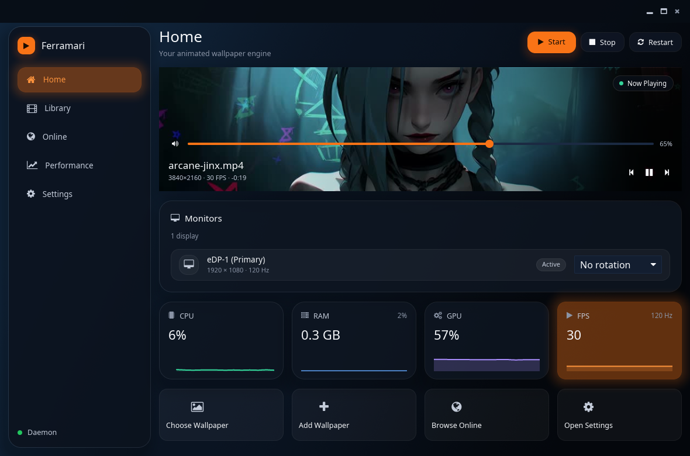
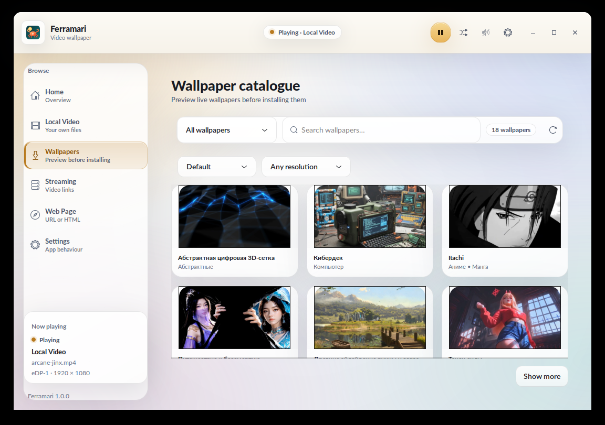
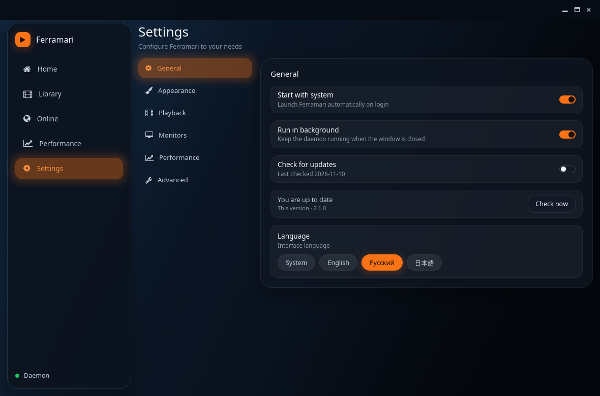
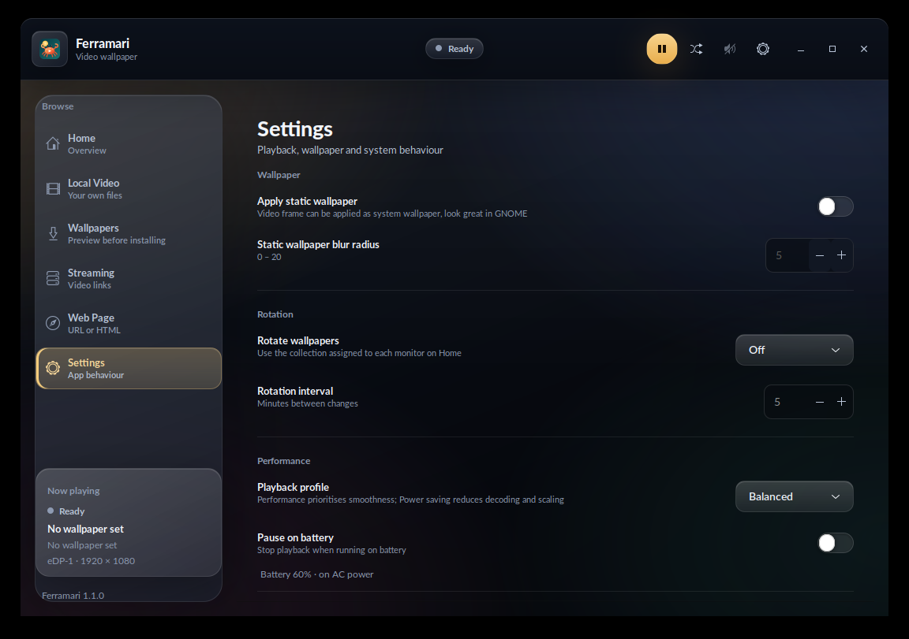

# Ferramari 🦀

Video wallpaper for Linux, written in Rust.


Ferramari makes video content your desktop wallpaper. Web-page wallpapers are temporarily unavailable during the GTK-free migration. The name nods to
iron (*ferrum*) and Rust's crab mascot.

## Screenshots

| Home | Catalogue | Settings |
| --- | --- | --- |
|  |  |  |

The interface has a hand-tuned dark palette as well as the light one:

| Settings, dark theme |
| --- |
|  |

## Features

- Play a local video as the wallpaper, one video per monitor
- Home page with the current wallpaper and per-monitor cards
- Local library with favorites, recently used wallpapers and collections
- Automatic wallpaper rotation from a per-monitor collection (order or random)
- Eco Engine: per-monitor `Active`/`Idle`/`Occluded`/`Suspended` state,
  automatic pause when a monitor is covered or fullscreen, configurable idle
  handling and the Quality/Balanced/Eco profiles; optional pause on battery
- Decoder parking: a local video paused out of sight for five minutes releases
  mpv's file and decoder, then resumes at the same position
- Per-monitor Eco state on Home cards and in the D-Bus `monitor_states`
  property
- Event-driven X11 window watcher (no 300 ms polling)
- Performance page with live CPU, RAM, thread, process and (where available)
  GPU metrics
- Hardware decoding selector (Auto / VA-API / Off)
- Web-page wallpapers are temporarily unavailable while a GTK-free browser engine is evaluated; the current media backend reports this explicitly instead of silently failing
- Reproducible benchmark harness (`make bench`) for startup, CPU, RAM,
  processes, GPU and mpv recovery
- `--doctor` diagnostics for session/backend, desktop, media tools, DRM nodes,
  idle and lock services
- Logind lock/unlock fallback, aggregated with screensaver lock state
- `.ferramari` package import/export with strict metadata, path, symlink, file
  count and size validation, plus SHA-256 checksums and Ed25519 signatures
  with a local trust store
- Declarative catalogue-source plugins (no plugin code execution) and a
  first-party Catalog API v1 client (`--catalog`)
- Browse a catalogue of live wallpapers with categories, search, sorting,
  resolution filters and a six-frame preview before installing
- Streaming URLs through `yt-dlp` (YouTube and many other sites)
- Web-page wallpapers are currently unavailable; a replacement browser engine is required before this feature can return
- GNOME static wallpaper with a blurred frame from the video
- Pause or mute playback per monitor when that monitor is covered by a
  maximized or fullscreen window (X11); the other monitors keep playing
- Pause while the screen is locked; clean shutdown on logout/reboot
- Automatic recovery when mpv dies, with capped backoff and a visible error
  after repeated failures
- Volume control with fade in/out, mute toggle
- Autostart after login
- “I'm Feeling Lucky” random video
- Tray icon (StatusNotifierItem) for GNOME/KDE and friends
- Settings page grouped by playback, wallpaper and system behaviour
- English, Russian and Japanese interface; the language can be changed in
  Settings
- Light, dark or system colour scheme; changes apply immediately
- Config format schema version 4, including the 3.x → 4 migration
- D-Bus API for scripting and the tray/CLI

## Requirements

### Runtime

| Dependency | Why |
| --- | --- |
| `mpv` | video playback (embedded through `--wid` and controlled via JSON IPC) |
| `ffmpeg` / `ffprobe` | static wallpaper frame, thumbnails |
| `yt-dlp` | only for streaming mode; use a current release (distro packages are often too old for YouTube) |

The current wallpaper surface backend uses X11 directly. On Wayland sessions it relies on XWayland; native Wayland wallpaper surfaces are not implemented.

### Build

- Rust 1.88+ (a `rust-toolchain.toml` pins stable)
- `pkg-config`, a C compiler
- gettext (`msgfmt`) to build the translations; without it the app still
  builds and runs, but only the source (English) strings are installed

Debian/Ubuntu:

```sh
sudo apt install build-essential pkg-config gettext
```

Fedora:

```sh
sudo dnf install gcc pkgconf-pkg-config gettext
```

Arch Linux:

```sh
sudo pacman -S base-devel pkgconf gettext
```

## Build, test, install

```sh
cargo build --workspace --release --locked
cargo test --workspace --locked
cargo clippy --workspace --all-targets --locked -- -D warnings
cargo fmt --all -- --check
```

Install (binary, desktop entry, AppStream metadata, icon, translations):

```sh
# build as your user, then only install as root:
cargo build --workspace --release --locked
sudo make install CARGO=true            # PREFIX=/usr/local by default
sudo make install CARGO=true PREFIX=/usr

# per-user, no root:
make install PREFIX="$HOME/.local"

# staged install
make install DESTDIR=/tmp/package PREFIX=/usr
```

`CARGO=true` stops the install target from invoking cargo as root (root often
cannot see the rustup toolchain in your home directory).

Uninstall with `sudo make uninstall` (same `PREFIX`).

### Flatpak

A self-hosted Flatpak manifest is available in `flatpak/`. It builds the app
against the GNOME runtime and uses the host's `mpv`, `ffmpeg` and `yt-dlp`
through `flatpak-spawn`; a Flathub submission with bundled media tools is not
ready yet. See [`flatpak/README.md`](flatpak/README.md) for build and test
instructions.

## Usage

```sh
ferramari             # start the wallpaper server and open the control window
ferramari -b          # background: live wallpaper only
ferramari -b -p 5     # wait 5 seconds before starting (autostart delay)
ferramari -d          # debug logging
ferramari -r          # reset the configuration
ferramari --doctor    # print session/backend/tool diagnostics and exit
ferramari --catalog https://catalog.example.org/v1  # inspect a Catalog API
ferramari package --help    # checksum, sign and verify .ferramari packages
```

A second `ferramari` invocation does not start another wallpaper server: it asks the running server to launch the separate `ferramari-ui` control-surface binary and exits. Both binaries must be installed side by side.

Local videos are read from `$XDG_VIDEOS_DIR/Ferramari` (usually
`~/Videos/Ferramari`). The control window can open that folder, refresh the
thumbnail grid, and apply a video to one monitor or all of them.

### Packages

Local Video → **Import…** accepts a `.ferramari` directory. A video package is
installed under `$XDG_DATA_HOME/ferramari/packages`, applied to all monitors
and shown in the library progress; a web package is applied as the current web
wallpaper. Select a video and use **Export .ferramari** to create a package in
a folder of your choice. The format, manifest fields and security limits are
documented in [`docs/FERRAMARI_FORMAT.md`](docs/FERRAMARI_FORMAT.md).

Exported and imported packages can carry integrity data. `checksums.json`
records the SHA-256 of every file, and `signature.json` holds an Ed25519
signature over those checksums, so one signature covers the whole package.
Ferramari creates a signing key on first use
(`~/.config/ferramari/signing-key.json`, mode `0600`) and signs exports
automatically. Verification distinguishes four states — trusted, signed by an
unknown author, unsigned and invalid — and trusting a key is always an explicit
choice in **Local Video → Verify**, **Settings → Package signing** or
`ferramari package trust`. Packages without checksums or signatures stay
usable.

### Wallpaper catalogue

The **Wallpapers** page lists live wallpapers: pick a category, search, or load
more pages. Opening a card shows the still preview; after you press
**Download** it fetches the file, reads the metadata (size, resolution, frame
rate, duration) and builds a 3×2 sheet of frames, so you can inspect the motion
before deciding. **Install…** puts the video into
`$XDG_VIDEOS_DIR/Ferramari` and opens the same monitor menu as a local video.
**Apply…** reuses the installed file.

Downloads only start when you ask for them. Previews, archives and extracted
videos are cached in `$XDG_CACHE_HOME/ferramari/catalogue` (default
`~/.cache/ferramari/catalogue`); cached videos older than seven days or beyond
the 2 GB budget are removed on start, and **Remove download** deletes one
entry.

### D-Bus

The server owns `io.github.ferramari.Ferramari.server` and exports
`io.github.ferramari.ferramari.server` at
`/io/github/ferramari/ferramari/server`. The player interface
(`io.github.ferramari.ferramari.player`) mirrors it.

```sh
# switch to a video
gdbus call --session --dest io.github.ferramari.Ferramari.server \
  --object-path /io/github/ferramari/ferramari/server \
  --method io.github.ferramari.ferramari.server.video /path/to/video.mp4 ""

# set the volume (0-100)
gdbus call --session --dest io.github.ferramari.Ferramari.server \
  --object-path /io/github/ferramari/ferramari/server \
  --method org.freedesktop.DBus.Properties.Set \
  io.github.ferramari.ferramari.server volume '<int32 30>'

# quit
gdbus call --session --dest io.github.ferramari.Ferramari.server \
  --object-path /io/github/ferramari/ferramari/server \
  --method io.github.ferramari.ferramari.server.quit
```

### Configuration

`$XDG_CONFIG_HOME/ferramari/config.json` (default
`~/.config/ferramari/config.json`). The format uses schema version 4; unknown
keys are ignored, missing keys get defaults, and a schema-3 file is migrated on
first start.

Favourites, history and collections live next to it in `library.json`.

Both files are written atomically through a temporary file and rename; the
previous good copy is kept as `.json.bak`. A truncated or invalid
`config.json` is restored from that backup instead of silently resetting the
settings.

### Eco Engine

Every monitor is evaluated independently. The engine combines the session
state (user pause, screen lock, suspend, battery rule) with that monitor's own
occlusion sample (a maximized/fullscreen window covering it) and desktop idle
time:

| State | Playback |
| --- | --- |
| `Active` | normal |
| `Idle` | Balanced caps the frame rate at 30 fps; Eco pauses after the configured idle delay (5 min default) |
| `Occluded` | paused when **Pause when maximized window** is on (X11 sessions) |
| `Suspended` | paused on lock, suspend, battery rule or explicit pause |

The profiles are **Quality** (smoothness first), **Balanced** (pause hidden
monitors, lower the frame rate when idle) and **Eco** (also stop when idle).
The idle delay is configurable in Settings. The on-disk identifiers stay
`performance`, `balanced` and `power` so older configs keep working.

When a local video has been paused for five minutes while its monitor is
invisible (occluded, locked or suspending), Ferramari unloads the file and
releases the decoder. The mpv process and its IPC socket stay alive; resuming
reloads the same source at the saved position. Parking never runs for an
explicit user pause or a visible Eco idle, so the desktop cannot show a black
frame. Streams are excluded because their separate audio track and expiring
URLs make a reload unreliable.

### Theme

Ferramari follows the desktop colour scheme by default and also ships a
hand-tuned dark palette. Choose **Settings → System → Theme** → System
default, Light or Dark; the window, popovers and dialogs switch immediately.
The choice is stored as `"theme"` in `config.json` and exposed as the `theme`
D-Bus property.

### Language

The interface follows the desktop locale (`LANG`/`LANGUAGE`). It can also be
chosen explicitly in **Settings → System → Language**:
System default, English, Русский or 日本語. Applying a different language takes
effect after restarting Ferramari. Catalogs live in `po/*.po`; `make install`
compiles them with `msgfmt`.

## Architecture

The application is split into a wallpaper server and a separate Iced control surface. The server owns media playback and system integration; the UI is an ordinary D-Bus client:

```
             ferramari-ui (Iced)
                    │
             session D-Bus API
                    │
             ferramari server
          ┌─────────┼──────────┐
          ▼         ▼          ▼
       Core      Platform    Media
       policy    Linux/X11   mpv + X11
```

| Path | Responsibility |
| --- | --- |
| `src/app.rs` | wallpaper-server state, command handling and mode switching |
| `crates/ferramari-ui` | separate Iced control surface and D-Bus client |
| `crates/ferramari-core` | shared configuration, policy, catalogue, packages and data models |
| `crates/ferramari-platform` | Linux session, tray, D-Bus, monitor and desktop integration |
| `crates/ferramari-media` | mpv process control and native X11 wallpaper surfaces |
| `src/app.rs` | wallpaper-server state machine and command handling |
| `crates/ferramari-ui/src/main.rs` | Iced pages, UI state and D-Bus client calls |
| `crates/ferramari-ui/src/client.rs` | D-Bus client and server-state snapshot |
| `crates/ferramari-core/src/eco.rs` | pure per-monitor Eco Engine policy and profiles |
| `crates/ferramari-core/src/config.rs` | schema-v4 config, validation and 3.x migration |
| `crates/ferramari-core/src/package.rs` | `.ferramari` manifest validation, import and export logic |
| `crates/ferramari-core/src/catalogue.rs` | catalogue listing/search, cache, download and frame generation |
| `crates/ferramari-platform/src/dbus.rs` | zbus server/player interfaces and single-instance server ownership |
| `crates/ferramari-platform/src/monitors.rs` | XRandR monitor discovery and hotplug watcher |
| `crates/ferramari-platform/src/tray.rs` | StatusNotifierItem tray (`ksni`) |
| `crates/ferramari-media/src/engine.rs` | per-monitor wallpaper playback engine |
| `crates/ferramari-media/src/surface.rs` | native X11 wallpaper windows and mpv embed IDs |

Threading rule: the Iced UI owns its widget tree on its event-loop thread. The wallpaper server owns media engines on its command-loop thread. The processes exchange commands and snapshots over the session D-Bus; background work returns plain data through channels or Iced tasks.

The Iced control window's Liquid Glass design system (tokens, material layers,
typography, motion and accessibility rules) is documented in
[`docs/DESIGN.md`](docs/DESIGN.md). The stylesheet lives in
`data/ui/ferramari.css` and is compiled into the binary.

## FAQ

**Does it work on native Wayland?**
No. Ferramari runs through XWayland on Wayland sessions. A desktop-type
window and `mpv --wid` embedding need X11; native Wayland needs a compositor
specific surface and is not claimed.

**Does it work on KDE?**
The code uses standard X11/EWMH paths, but KDE is not part of the tested
matrix yet. Treat it as unsupported until the checklist in
`docs/TESTING.md` has been run there.

**Where do I put my videos?**
In `$XDG_VIDEOS_DIR/Ferramari` (usually `~/Videos/Ferramari`). The video folder
is not recursive.

**The catalogue shows no resolution/size/duration.**
Those values are learned from previews and downloads and cached; cards that
have never been previewed cannot be filtered by resolution yet.

**Why does mpv/ffmpeg not start?**
Install `mpv`, `ffmpeg` and `ffprobe`. Streaming also needs a current
`yt-dlp`. The error dialog names the missing tool.

**How do I rotate wallpapers?**
Create a collection in Local Video, assign it to a monitor on Home, then
choose Off/In order/Random and an interval in Settings → Rotation.

**Is there a Flatpak?**
Yes, a self-hosted bundle manifest is in `flatpak/`. It uses the host `mpv`,
`ffmpeg` and `yt-dlp` through `flatpak-spawn`; Flathub packaging is not ready.

## Known limitations

- The wallpaper server currently uses X11/XWayland: a wallpaper window is
  a `DESKTOP`-type X11 toplevel and mpv embeds into it with `--wid`. Native
  Wayland has no background role in `xdg-shell`, and `wlr-layer-shell` is not
  available on GNOME, so native Wayland windows are not an option.
- Pause/mute when maximised needs `_NET_CLIENT_LIST`, which only lists X11
  windows. On a Wayland session it therefore works for X11/XWayland clients
  (measured: a fullscreen mpv window is listed with
  `_NET_WM_STATE_FULLSCREEN`) but never for native Wayland windows.
- Fractional scaling and mixed-DPI layouts are upscaled by XWayland; expect
  softer output than a native Wayland client.
- KDE Plasma and GNOME X11 are not part of the tested matrix yet; the
  XWayland desktop window is the only supported path there. `--doctor` reports
  what the current session actually exposes instead of guessing.
- Occlusion pause is driven by the X11/EWMH watcher, which runs on X11 and on
  Wayland sessions (through XWayland). Wayland-native windows are not exposed
  through EWMH at all, so a native fullscreen app cannot be detected there;
  an X11 fullscreen window can, and is.
- The Flatpak bundle is self-hosted and uses host media tools. Tray and portal
  autostart inside the sandbox are not verified.
- Two- and three-monitor performance scenarios are not measured on the current
  single-display test machine.
- Streaming currently uses one shared source for all monitors; local video
  sources are assigned independently. Web-page wallpapers are temporarily
  unavailable in 2.0.0.
- The Performance page reports GPU usage only where the driver exposes
  `gpu_busy_percent` (currently AMDGPU). NVIDIA/Intel utilisation is shown as
  unavailable.
- Multi-monitor, 4K/60, locked-screen and long-idle benchmarks are not yet
  measured on the single-display test machine. Single-monitor 1080p, synthetic
  4K and local-canvas web results are in `docs/BENCHMARKS.md`.
- Decoder parking is limited to local videos; streams keep their process alive
  because their separate audio track and expiring URLs make a reload fragile.
- `.ferramari` packages can be imported and exported, but there is no separate
  package manager/metadata editor yet: imported packages are applied on import
  and video entries appear in the library.
- The plugin API is declarative catalogue sources only. Executable renderer
  plugins, a plugin installer and a hosted first-party catalogue/server are not
  implemented.

## Implementation notes

- GTK/GDK are no longer used by the default application build. Web-page wallpapers are temporarily disabled because the former WebKitGTK renderer was removed; an alternative browser process/engine has not yet been integrated.
- Streaming needs a recent `yt-dlp`. The Ubuntu package can be months behind
  and then returns YouTube URLs that mpv cannot open (HTTP 403). The official
  binary is installed next to `ferramari` and is preferred automatically:

  ```sh
  sudo curl -L https://github.com/yt-dlp/yt-dlp/releases/latest/download/yt-dlp_linux \
    -o /usr/local/bin/yt-dlp
  sudo chmod +x /usr/local/bin/yt-dlp
  ```

- `mpv` is embedded with `--wid`, uses `--panscan=1.0` for the center-crop
  effect and is driven through its JSON IPC socket.
- The server and Iced control surface are separate processes. The existing D-Bus method and property shape stays stable for scripts and desktop integrations.
- Window state detection uses EWMH atoms over X11.
- `-b` starts only the wallpaper, `-p` adds a startup delay, and `-r` resets the
  config (only when no instance is running).
- A Flatpak manifest exists, but it still targets the pre-Iced GNOME/WebKitGTK build and has not been migrated or validated for the 2.0 workspace.

## Testing notes

`cargo test --workspace` covers config parsing/migration (including per-field corruption),
atomic saves and backup recovery, the player restart policy, yt-dlp and ffmpeg
timeouts, per-monitor EWMH coverage, Eco Engine decisions, mpv IPC framing and
the worker command order, process-tree metric parsing, session/desktop
classification, monitor naming/scaling, the fade maths, path handling, URI
safety, `.ferramari` validation/import/export, plugin manifest validation,
Catalog API parsing/client validation and the catalogue parsers (cards,
categories, search, signed download links, archive extraction, video probing
and frame sheets).
The former GTK GUI, video embedding, streaming, webpage, catalogue and library modes were smoke-tested on Ubuntu 26.04 / GNOME Wayland (XWayland) before the 2.0 migration. The Iced control surface and current X11 media surface require a fresh live-session smoke run; CI compilation alone does not prove correct wallpaper stacking, mpv embedding or tray activation. The full environment
matrix and smoke checklist live in [`docs/TESTING.md`](docs/TESTING.md). To exercise the
static-wallpaper code without touching your real background:

```sh
GSETTINGS_BACKEND=memory ferramari -b -d
```

## Contributing

See [`CONTRIBUTING.md`](CONTRIBUTING.md), [`ROADMAP.md`](ROADMAP.md) and the
[`docs/TESTING.md`](docs/TESTING.md) matrix. The 2026-11-01 architecture audit
and its open findings live in [`docs/AUDIT.md`](docs/AUDIT.md); reproducible
measurements are in [`docs/BENCHMARKS.md`](docs/BENCHMARKS.md), the package
format in [`docs/FERRAMARI_FORMAT.md`](docs/FERRAMARI_FORMAT.md), and the
ecosystem contracts in [`docs/PLUGIN_API.md`](docs/PLUGIN_API.md) and
[`docs/CATALOG_API.md`](docs/CATALOG_API.md).

## License

GPL-3.0-or-later. See `LICENSE`.